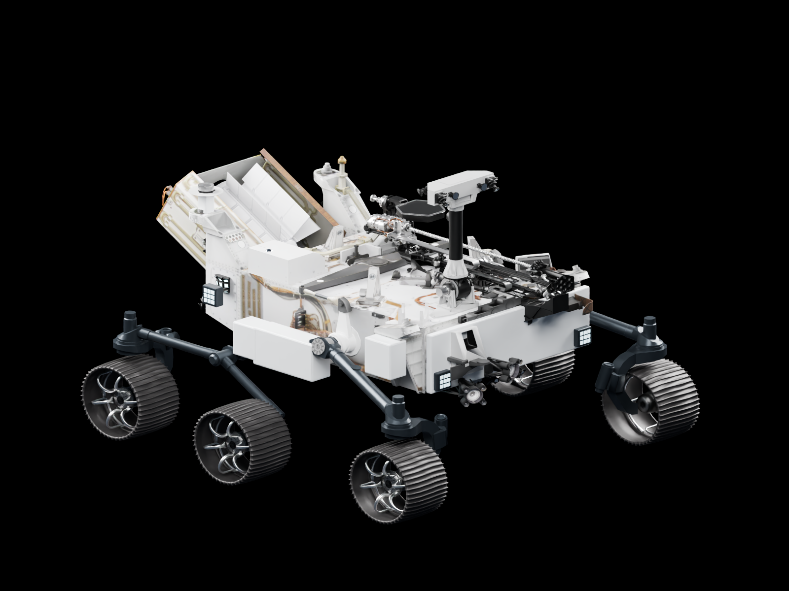

# PROMISE rover — NASA-derived simulation model

Built against NASA's **November 7, 2026 PROMISE announcement** and the public PROMISE visualization available on November 8, 2026. This is an articulated reconstruction for simulation and visualization, **not NASA flight CAD or a validated dynamics model**.

The body and rocker-bogie geometry come from NASA's Curiosity model. All six wheel meshes come from NASA's Perseverance model. The original Curiosity arm, large head and mast, and Mars-specific instrument objects were removed. The current PROMISE compact mast/head, stowed drill and payload details were manually integrated from NASA's newly released PROMISE visualization. Additional enclosures, arm deletion cover and illuminator arrays were modeled against the release rendering.



## Files

Keep the folder structure intact: URDF, MJCF and USD use accompanying mesh or texture files.

| Requested format | Entry point | What is included |
|---|---|---|
| ROS 2 / Gazebo URDF | `ros2/promise_description/urdf/promise.urdf` | 27 links including sensor frames; 16 movable joints; inertials and simplified collisions |
| Gazebo configuration | `ros2/promise_description/urdf/promise.gazebo.urdf.xacro` | ROS 2 control, four cameras, camera calibration, controller launch and a lunar-gravity world |
| MuJoCo 4.0 MJCF | `mujoco/promise.xml` | Native MJCF, floating base, 12 actuators, passive suspension, rocker differential, cameras, IMU and ground |
| General GLB | `glb/promise.glb` | glTF 2.0, embedded textures, named link hierarchy and one six-wheel animation |
| Animated Blender | `blender/promise_wheel_animation.blend` | Editable meshes, named link pivots, packed textures, studio lights and an eight-second wheel loop |
| Isaac Sim USD | `usd/promise.usdc` | Rigid bodies, articulation, joints, collision shapes, drives, camera prims and PhysX rocker mimic metadata |
| Isaac Sim scene | `usd/promise_scene.usda` | References the rover; adds a ground plane, lighting and lunar gravity |

`data/robot_spec.json` records link frames, masses, inertias, materials, collisions, camera estimates and donor provenance. `validation.json` records the checks actually run.

## Geometry and assumptions

| Item | Implementation |
|---|---|
| Coordinates | Meters, radians, ROS FLU: +X forward, +Y left, +Z up |
| Base | `base_link` at nominal body height 0.90 m; `base_footprint` is a fixed frame 0.90 m below it |
| Wheels | Six NASA Perseverance wheel meshes, normalized to a 0.525 m tread diameter; independent +Y spin axes |
| Steering | Front and rear wheels steer; middle wheels stay aligned with their bogie |
| Suspension | One rocker and one bogie on each side; the front/aft rocker tubes are one rigid body |
| Rocker differential | `q_left + q_right = 0`; implemented as URDF mimic, MJCF equality, and USD PhysX mimic |
| Head | Compact NASA PROMISE head; manually assigned yaw and pitch joints |
| Stereo interpretation | Two forward stereo pairs: `stereo_left/right` and `dashcam_left/right`; four virtual cameras |
| Camera estimates | 1280 × 720, 10 Hz, 70° horizontal FOV; estimated baselines 0.40 m and 0.31 m |
| Arm | Removed; no Curiosity arm links or arm control chain |
| Drill | TRIDENT is fixed in the stowed driving pose; deployment and drilling are not simulated |
| Estimated mass | 900 kg total; editable, not an asserted PROMISE flight mass |
| Dynamics | Estimated inertias, limits, damping, gains and friction; smooth-cylinder wheel contact |
| Terrain | Rigid flat ground; no granular regolith, sinkage, soil shear or tread-resolved contact |

The published picture in the supplied Google link shows the drill deployed. The delivered driving configuration follows the stowed drill in NASA's interactive model. The body, wheels and compact head remain the same design. Small exterior boxes and lights are approximations; no unprovided engineering dimensions are represented as measured flight values.

Some Curiosity visual detail is lower resolution than the new PROMISE visualization because the requested Curiosity donor body was retained. Material colors on the mobility tubes were changed to match the dark finish in the PROMISE release.

## Run in MuJoCo 4.0

From this folder, with `uv` installed:

```bash
uv run --python 3.12 --with mujoco==4.0.0 scripts/mujoco_demo.py
```

Headless forward drive or a turning drive:

```bash
uv run --python 3.12 --with mujoco==4.0.0 scripts/mujoco_demo.py --headless --seconds 12
uv run --python 3.12 --with mujoco==4.0.0 scripts/mujoco_demo.py --speed 0.10 --yaw-rate 0.03
```

The demo settles for two seconds and ramps the commanded speed over two more seconds. `--gravity 9.81` selects Earth gravity. The validated default is lunar gravity, 1.62 m/s². The interactive example uses MuJoCo's Python viewer; the native XML can also be opened by compatible MuJoCo 4.0 tools.

The six wheel actuators are torque-limited velocity servos. Four steering and two mast actuators are position servos. Actuator names are exposed in the XML. The two rockers and two bogies are passive. The rocker equality has finite solver compliance.

## Run with ROS 2 Jazzy / Gazebo Harmonic

The ROS package targets your Ubuntu 24.04 / Jazzy setup. Gazebo Harmonic is the intended Gazebo version. Install the dependencies in a ROS-enabled terminal:

```bash
sudo apt install ros-jazzy-ros-gz ros-jazzy-gz-ros2-control \
  ros-jazzy-ros2-controllers ros-jazzy-xacro
```

Copy `ros2/promise_description` into a colcon workspace's `src` directory, then:

```bash
source /opt/ros/jazzy/setup.bash
colcon build --packages-select promise_description --symlink-install
source install/setup.bash
ros2 launch promise_description gazebo.launch.py
```

In another sourced terminal:

```bash
ros2 topic pub -r 10 /cmd_vel geometry_msgs/msg/Twist \
  '{linear: {x: 0.10}, angular: {z: 0.0}}'
```

The adapter computes six wheel speeds and four corner steering angles. It stops wheel commands after 0.5 seconds without a new message. Commands beyond the modeled steering or speed limits stop the rover and log a warning. Lateral `linear.y` commands are not supported. No odometry estimator, navigation stack, or `odom -> base_link` publisher is supplied.

Direct controller topics:

| Topic | Message / order |
|---|---|
| `/wheel_controller/commands` | `std_msgs/msg/Float64MultiArray`; front-left, middle-left, rear-left, front-right, middle-right, rear-right; rad/s |
| `/steering_controller/commands` | Same message; front-left, rear-left, front-right, rear-right; radians |
| `/mast_controller/commands` | Same message; mast yaw, head pitch; radians |
| `/joint_states` | `sensor_msgs/msg/JointState` |
| `/promise/{camera}/image` | Image for each of the four camera names in the table above |
| `/promise/{camera}/camera_info` | Estimated rectified calibration, synchronized to each image's header |

`stereo_info.py` supplies the nonzero right-camera projection term `P[3] = -fx × baseline`. Independent Gazebo cameras otherwise provide monocular projection matrices. The calibration is synthetic, not flight calibration. `imu_link` is a frame in the ROS model; an IMU sensor is implemented in MJCF only. SCAN-3D hardware is represented visually; a lidar scan sensor and science-instrument data models are not implemented.

The bare `promise.urdf` is useful for RViz, URDF importers or other simulators. The xacro wrapper adds Gazebo-specific control and sensors. Gazebo's ros2_control velocity/position command interfaces do not reproduce the same actuator servo dynamics as MJCF.

## Blender and GLB

Open `blender/promise_wheel_animation.blend` in **Blender 4.5 or newer** and press Space. Frames 1–240 are an eight-second loop at 30 fps. Each wheel turns about its own axle; the rover stays in place for this animation demonstration. The key at frame 241 closes one full revolution. The wheel animation is not a simulated vehicle trajectory.

The GLB contains the same wheel animation as a single clip, with all textures embedded. Its glTF coordinates follow the standard +Y-up convention; the exporter converts the common Z-up model. Blender, ROS, MJCF and USD remain Z-up.

## Isaac Sim

Open `usd/promise_scene.usda` in Isaac Sim. Keep `promise.usdc` and the `textures` directory beside it. Press Play to settle the floating rover under lunar gravity. The articulation root API is on `/World/PROMISE/base_link`.

Joint prims are under `/World/PROMISE/Joints`. Six wheel angular drives are velocity drives; corner steering and mast drives are position drives. **USD drive angles and target velocities use degrees and degrees/second**, unlike ROS and MJCF. The helper converts them:

```bash
# Run from the Isaac Sim installation, using its Python environment:
./python.sh /absolute/path/promise_rover/scripts/isaac_demo.py
```

The helper targets the current `isaacsim` / `isaacsim.core.api` API family. Four camera prims are included beneath `head_pitch_link`; create render products in Isaac Sim for image output. A ROS bridge / OmniGraph pipeline is not embedded.

PhysX's documented mimic equation is `q_target + gearing*q_reference + offset = 0`, so the rocker mimic uses gearing **+1**. The URDF multiplier is **-1** for the equivalent relation. The PhysX schema is intentionally authored in USD even though standalone OpenUSD cannot evaluate it.

## What was verified

The generated files were verified with Blender 4.5.3, MuJoCo **4.0.0**, yourdfpy, xacro and OpenUSD 26.11. See `validation.json` and `references/blender_validation.json` for the recorded results.

| Check | Result |
|---|---|
| URDF and all referenced Collada meshes | Parsed successfully; 27 links, 16 movable joints; nominal transforms match the common specification |
| Gazebo xacro | Expanded; four camera sensors and 16 ros2_control joint declarations |
| MuJoCo stationary / forward / turning tests | Passed, finite state, zero numerical warnings, all six wheels touching ground at each test end |
| MuJoCo forward run | 12 s simulated; approximately 0.862 m traveled after settling / acceleration |
| Rocker differential | Maximum residual below 0.0006 rad in these flat-ground tests |
| MuJoCo rendering | Textured model rendered successfully with EGL |
| GLB | Valid binary container, embedded images, one animation driving all six wheels |
| Blender | Reopened; six wheel actions checked at half cycle |
| USD | Composed successfully, 17 rigid bodies, 16 revolute joints, no unresolved references |
| Gazebo and Isaac Sim runtime | **Not run**: these applications were unavailable in the build environment |

These checks establish file integrity and basic flat-ground behavior, not mission performance, terrain fidelity or flight qualification.

## Rebuild or modify

Use `scripts/build_geometry.py` for mesh selection, geometry changes, link anchors, mass and camera estimates. `scripts/export_simulators.py` exports the common specification to simulator formats. Changing only `data/robot_spec.json` updates simulator exports but does not change the existing Blender/GLB meshes; rebuild geometry when changing visual placement.

```bash
uv venv .build-bpy --python 3.11
uv pip install --python .build-bpy/bin/python bpy==4.5.3 pillow numpy
uv venv .build-sim --python 3.12
uv pip install --python .build-sim/bin/python mujoco==4.0.0 usd-core==26.11 \
  numpy scipy trimesh yourdfpy xacro pillow

.build-sim/bin/python scripts/fetch_sources.py
.build-bpy/bin/python scripts/inspect_sources.py
.build-bpy/bin/python scripts/build_geometry.py
.build-sim/bin/python scripts/export_simulators.py
.build-sim/bin/python scripts/validate.py
```

The source archives are included in the complete package. `fetch_sources.py` verifies their pinned hashes and extracts them; it downloads missing files from NASA. It stops if NASA has replaced an asset with different bytes, so a changed source must be reviewed deliberately.

Source geometry is transformed, segmented and assigned joint pivots explicitly; this is not a renamed static rover mesh. Visual LOD reduction is rejected if it displaces vertices beyond the source bounds. Simulation contacts use independent simple shapes.

## NASA references and provenance

The dates below are the download/listing dates shown by NASA, not proof that every mesh was redesigned on that date. These were the newest relevant downloadable NASA listings found during this research.

1. [NASA announcement, November 7, 2026](https://www.nasa.gov/news-release/nasa-awards-moon-base-transportation-technology-science-projects/) — mission update, nuclear power and science payloads.
2. [NASA PROMISE mission](https://www.nasa.gov/mission/promise/) — Curiosity testbed body/mobility heritage, instrument descriptions and Lunar Dashcam.
3. [NASA PROMISE interactive model](https://www.nasa.gov/moonbase/promise-model/) — current compact mast and stowed-payload geometry. The downloaded GLB is `source_assets/promise_nasa.glb`.
4. [NASA Curiosity Rover (MSL)](https://science.nasa.gov/3d-resources/curiosity-rover-msl/) — Clean Blender ZIP, listing dated July 7, 2026; source for body, MMRTG/radiators and suspension.
5. [NASA Mars 2020 Perseverance Rover](https://science.nasa.gov/3d-resources/mars-2020-perseverance-rover/) — Blender ZIP listed October 16, 2026; GLB listed April 10, 2025. The Blender wheel geometry was used.
6. [NASA Perseverance wheel description](https://www.nasa.gov/solar-system/nasas-perseverance-mars-rover-gets-its-wheels-and-air-brakes/) — approximately 52.5/52.6 cm diameter, 48 curved grousers.
7. [Supplied image, resolved to NASA's PROMISE rendering](https://www.nasa.gov/wp-content/uploads/2026/11/promise-7.jpg) — visual comparison, deployed drill pose.
8. [Existing Space ROS Curiosity URDF/xacro](https://github.com/space-ros/simulation/tree/main/models/curiosity_path/urdf) — inspected as a kinematic reference, including `curiosity_mars_rover_properties.xacro` and `left_wheel_group.xacro`. Its old ROS transmission/plugin configuration was not copied into this package.
9. [Another existing Curiosity ROS model](https://github.com/OMRIFIJI/curiosity-mars-rover) — identified during the requested existing-URDF search.
10. [MuJoCo 4.0 changelog](https://mujoco.readthedocs.io/en/4.0.0/changelog.html), [Jazzy gz_ros2_control](https://control.ros.org/jazzy/doc/gz_ros2_control/doc/index.html), and [PhysX mimic joint schema](https://docs.omniverse.nvidia.com/kit/docs/omni_usd_schema_physics/latest/physxschema/class_physx_schema_physx_mimic_joint_a_p_i.html) — simulator implementation references.

NASA/JPL-Caltech supplied the source visualization assets. The derived model and generated code are independent modifications, with no NASA endorsement. Source hashes are in `references/source_checksums.json`; object-level edits are recorded in `data/robot_spec.json`. See `NOTICE.md` for asset attribution and `LICENSE` for newly written code.
